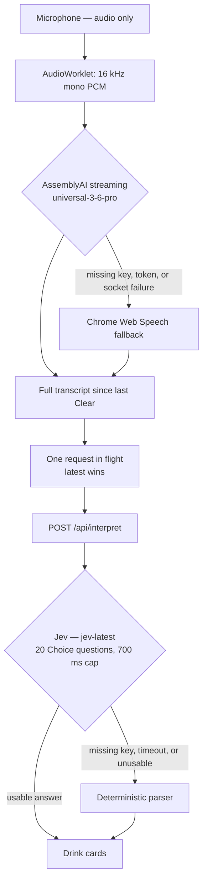

# Flash Agentic — Voice Coffee

A voice coffee counter that rebuilds your order while you are still talking — about 200 milliseconds from word to screen.

**Live demo:** [https://voice-coffee.vercel.app](https://voice-coffee.vercel.app)

Speak a coffee order and drink cards appear and update in place. Correct yourself mid-sentence, and the cards follow. There is no submit button.

## What it does

The counter understands three drinks — **Matcha Latte**, **Cappuccino**, and **Caffè Latte** — each with size (Tall, Grande, Venti), shots, milk (Whole, Oat, Almond, Skim), and hot or iced. A new drink defaults to Grande, two shots, whole milk, and hot.

You can change your mind while you talk:

- “actually, make that a venti”
- “let’s make it iced, with oat milk”
- “change the cappuccino to a latte”
- “get rid of the cappuccino”

Natural references work the way a person would say them: “it”, “that one”, “one of the lattes”, “the other one”, “the small one”. A changed option flashes gold, then settles back.

The full transcript since the last **Clear** is what the agent reads. Latest wins.

## Voice-to-UI pipeline

Speech-to-text prefers AssemblyAI real-time streaming (`universal-3-6-pro`). The browser captures the microphone (audio only — no camera), downsamples it to 16 kHz mono 16-bit PCM in an AudioWorklet (`/pcm-worklet.js`), and streams that PCM through AssemblyAI’s `StreamingTranscriber`. The API key never leaves the server. `GET /api/assemblyai-token` mints a short-lived token with `client.streaming.createTemporaryToken`; a `?probe=1` request only reports whether a key is configured. Partial turns show in the transcript pill as you speak and are posted to `/api/interpret`. If the socket drops or the session nears its cap, the page mints a new token and reconnects without dropping words already heard.

If `ASSEMBLYAI_API_KEY` is missing, the token request fails, or the socket errors, the page falls back to Chrome’s Web Speech API (`webkitSpeechRecognition`, `continuous` and `interimResults`, on-device when a language pack is available). A small label in the pill reads **AssemblyAI** or **Chrome**.

Live transcripts are read by [Jev](https://docs.typesafe.ai), TypeSafe’s System One model, through [`@typesafe-ai/sdk`](https://docs.typesafe.ai/sdk/javascript). The server calls `TypeSafeClient.systemOne` (`POST https://api.typesafe.ai/v1/systemone`, model `jev-latest`) with the full transcript since last Clear and twenty Choice questions — four drink slots, each with type, size, shots, milk, and temperature. The browser only learns whether a key is configured (`GET /api/interpret` returns `{ "jev": true|false }`). The key never leaves the server.

Jev has no published latency SLO. The SDK default is 10 seconds per attempt and two retries, which is too slow for a word that should land while the sentence is still going. This app turns retries off and caps each attempt at 700 ms. The page keeps a **single request in flight** and sends the latest transcript as soon as that request returns, so the screen trails speech by about one round trip. The scripted demo paints word-to-screen times in the 126–228 ms range.

If `JEV_API_KEY` is missing, a call fails or times out, or the answer is unusable, the same route uses a deterministic local parser. If the interpret request itself fails, the browser runs that parser too. Demo playback always uses the parser, so the eight-step script stays exact with or without a key. The pill labels the decision **Jev** or **parser**.



## UI

A start screen asks “What are you drinking?” Hand-drawn coffee glasses float in the corners and along the edges. The **Start** button is a sketch-circle; Enter or Space also begins. Start requests the microphone and opens the full-screen counter only after access is allowed. If the mic is blocked, the same screen explains how to allow it and Start tries again.

On the counter, an empty order shows “What can I get started for you?” Drink cards grow across the middle as the order takes shape. The transcript pill at the bottom shows interim words, the recognizer, the decision source, and a latency in milliseconds. The round meter reads **Start** until the microphone is allowed, then listening dots. The trash icon in the top-right clears the order once a session is underway.

**Play demo** stays in the top-left (including on the start screen) and the `D` key replays a scripted order with no microphone. `/?demo=1` autoplays it. Frozen frames for comparison, with the demo button hidden:

- `/?at=2400&shot=1` — prompt, “can i get”
- `/?at=4200&shot=1` — hot matcha
- `/?at=7200&shot=1` — iced oat matcha
- `/?at=11500&shot=1` — matcha, cappuccino, latte
- `/?at=15200&shot=1` — a second latte
- `/?at=19000&shot=1` — tall and venti lattes
- `/?at=23400&shot=1` — three shots and oat milk
- `/?at=33000&shot=1` — cappuccino removed, small latte iced

`at` is milliseconds from the start of the demo.

## Setup

**Prerequisites:** Node.js 20+ and a Chromium-based browser (Chrome or Edge) for the Web Speech fallback and the best microphone experience.

```bash
npm install
cp .env.example .env.local
npm test
npm run dev
```

Open [http://localhost:3000](http://localhost:3000). Both keys below are optional; the app runs without them, using the parser and Chrome speech.

### Environment variables

Create keys at [console.typesafe.ai/keys](https://console.typesafe.ai/keys) and the [AssemblyAI dashboard](https://www.assemblyai.com/dashboard). Put them in `.env.local` in this directory. Next.js loads that file on the server and does not expose it to the browser. Do not give either variable a `NEXT_PUBLIC_` prefix, and do not commit `.env.local`. `.env.example` is the only env file in git, and its values are empty.

```bash
JEV_API_KEY=
ASSEMBLYAI_API_KEY=
```

| Variable | If set | If missing or a call fails |
| --- | --- | --- |
| `JEV_API_KEY` | Live transcripts go to Jev | Deterministic parser |
| `ASSEMBLYAI_API_KEY` | Streaming speech-to-text | Chrome Web Speech |

Restart the dev server after saving. `GET /api/interpret` should return `{ "jev": true }` when the Jev key is present. `GET /api/assemblyai-token?probe=1` should return `{ "assemblyai": true }` when the AssemblyAI key is present — it does not include the key. The streaming token is minted only when you start the microphone.

`npm test` covers the parser, a mock Jev client, the speech session, AssemblyAI helpers, and the start-screen gates. It does not call TypeSafe or AssemblyAI.

### Deploy on Vercel

Import the repo into [Vercel](https://vercel.com) and set the same two server-only variables in the project’s environment settings (`JEV_API_KEY`, `ASSEMBLYAI_API_KEY`). Do not prefix them with `NEXT_PUBLIC_`. The live deployment is [https://voice-coffee.vercel.app](https://voice-coffee.vercel.app).

## Project structure

```
app/                      Next.js App Router
  api/assemblyai-token/   Short-lived streaming token
  api/interpret/          Jev, with parser fallback
  page.tsx                Full-screen counter
components/               Start screen, drink cards, floating glasses,
                          transcript bar, speech hook
lib/                      Parser, Jev client, latest-wins loop,
                          AssemblyAI helpers, demo script, types
public/pcm-worklet.js     16 kHz PCM AudioWorklet
public/drinks/            Drink card images
scripts/shoot.mjs         Frozen-frame screenshots
```

## Tech stack

- [Next.js](https://nextjs.org) 15 and React 19
- [AssemblyAI](https://www.assemblyai.com) streaming speech-to-text
- [Jev](https://docs.typesafe.ai) (`jev-latest` via [`@typesafe-ai/sdk`](https://docs.typesafe.ai/sdk/javascript))
- [Framer Motion](https://www.framer.com/motion/) and [Tailwind CSS](https://tailwindcss.com) 4
- Deployed on [Vercel](https://vercel.com)

## Fig AI Design Makeathon 2026 submission

Track 1: **Product Design for AI Agents**

**Project title:** Flash Agentic

**One-sentence summary:** A voice interface where the UI rebuilds your order in about 200 milliseconds as you speak, so you can change your mind mid-sentence and watch every card update instantly.

**Project description:**

Flash Agentic is a design study in real-time human-AI collaboration. Most AI agents make you wait: you type or speak, hit submit, and see a result seconds later. Flash Agentic removes the submit button. An agent listens while you talk and rebuilds the interface continuously, about 200 milliseconds from word to screen.

The demo is a voice coffee counter. Say "a grande iced matcha latte with oat milk" and the drink card appears before you finish the sentence. Say "actually, make that a venti" and only the size changes. Say "add a hot cappuccino with two shots... oh wait, change the cappuccino to a latte" and the agent edits the right card in place. You can refer to drinks the way a person would: "the other one", "the small one", "that one".

How it works: AssemblyAI streaming speech-to-text sends partial transcripts from the browser. On every update, the full transcript is sent to Jev, a fast decision model from Typesafe AI, which returns the complete intended order. The newest request always wins and only one is in flight at a time, so the UI never lags behind your voice. A local deterministic parser paints the first guess instantly and serves as a fallback, so the screen is never blank or stuck.

Design choices for AI agents:
- Show the agent's understanding live instead of after the fact, so mistakes are caught in the moment.
- Make correction the primary interaction: changing your mind is a normal sentence, not an undo flow.
- Update in place with calm motion, so the interface feels alive without being jumpy.
- A hand-drawn sketch-circle Start button and floating coffee glasses give a warm, human first impression.

The same pattern applies anywhere a person and an agent build something together: forms, configurators, checkouts, and dashboards that reshape themselves as you talk.

Built with Next.js, AssemblyAI, and Jev, deployed on Vercel. Inspired by Kunal Abichandani's voice ordering demo.

**Demo URL:** [https://voice-coffee.vercel.app](https://voice-coffee.vercel.app)

**Agent Blueprint Challenge (Portfolio Company Product Scenario):** No, this project is not for that challenge.

## Credit

Inspired by Kunal Abichandani's voice coffee ordering demo: https://x.com/kunalabcdani/status/2119892841723990319
